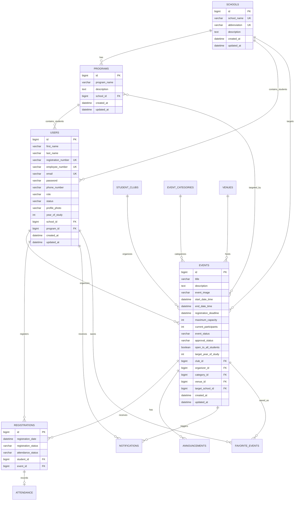

# Entity Relationship Diagram

Key constraints:

- `program_name + school_id` is unique.
- `student_id + event_id` is unique in registrations.
- `student_id + event_id` is unique in favorites.
- `event_id + program_id` is the composite key for event program targets.
- Venue conflicts are enforced in service logic using overlapping event windows.
