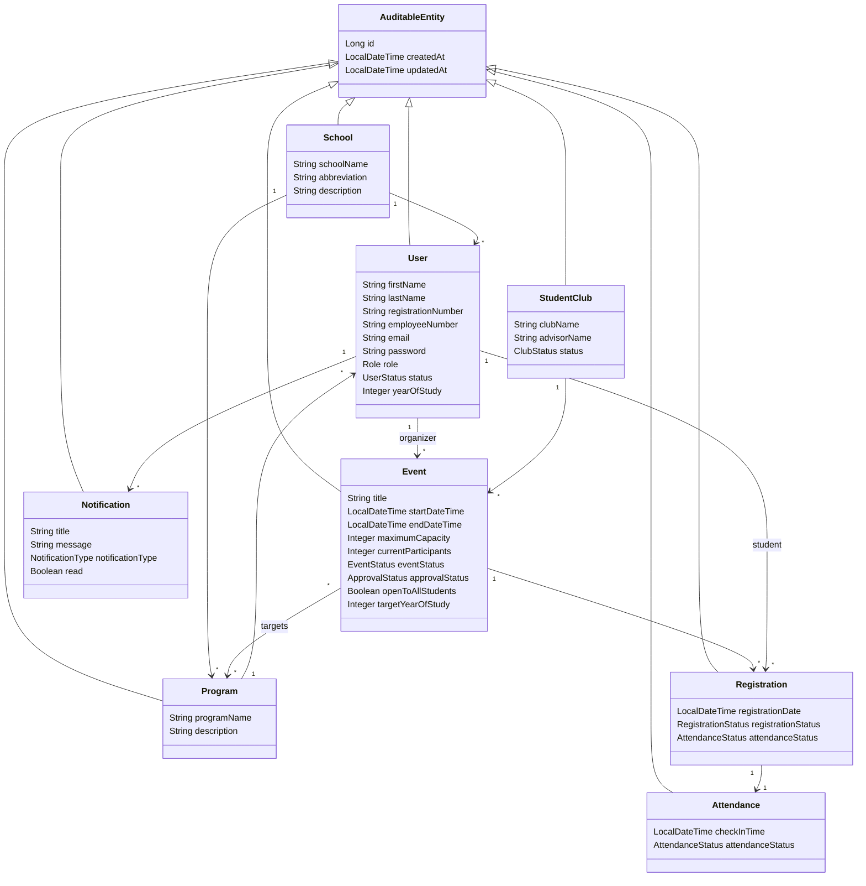

# UML Class Diagram

Service layer contracts:

- `AuthService`
- `UserManagementService`
- `CatalogService`
- `EventService`
- `RegistrationService`
- `AttendanceService`
- `AnnouncementService`
- `NotificationService`
- `FavoriteService`
- `AnalyticsService`
